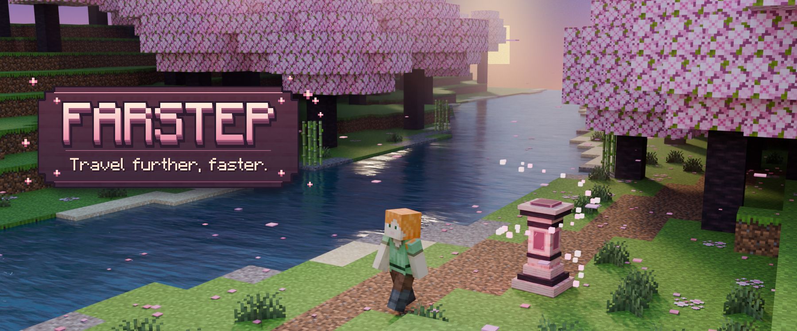

# Farstep

**Travel further, faster.**

Farstep adds craftable waystones to vanilla Minecraft Java. Place one at home and another where the trail takes you, then travel between them. This is the companion site, with the full recipe book and a guide in English and French.

[Open the Farstep guide](https://typholzz.github.io/farstep-site/)

## Find your way

- **Make your first trip.** Learn how to link destinations, name your stops and decide who can use them. [Player guide](https://typholzz.github.io/farstep-site/#guide)
- **Find a recipe.** Browse all 48 styles or search by biome, name or ingredient. Every recipe has a downloadable card. [Recipe book](https://typholzz.github.io/farstep-site/#recipes)
- **Set up Farstep.** Find the datapack, the resource pack and the installation instructions in one place. [Downloads and setup](https://typholzz.github.io/farstep-site/#downloads)

## Feedback

Found a bug, have an idea for Farstep, or want to help with a translation? [Open an issue](https://github.com/Typholzz/farstep-site/issues).

[Farstep datapack and resource pack source](https://github.com/Typholzz/farstep)
